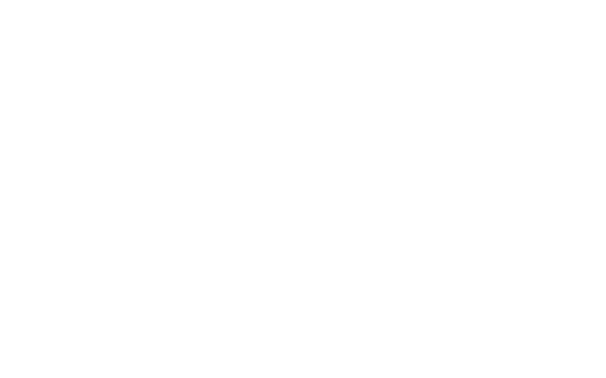
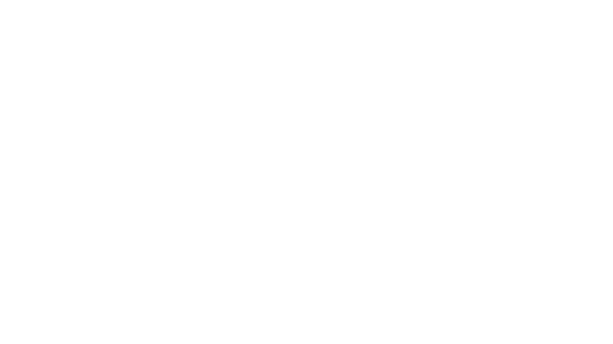

<div align="center">

# Halcyon

**A calm, from-scratch 3D modeling and animation suite for Linux. Part of the [Faded Dream Project](https://github.com/Faded-Dream-Project).**

</div>

---

Halcyon is being built as a long-term replacement for Blender, with a
different philosophy: **simple to learn, calm to use, able to export to
anything.** It is aimed at game assets — items, tools, props, characters —
and at pure animation. One clean window, a small set of obvious tools,
sensible defaults: a beginner should make and export a model in minutes,
and an expert should never fight the interface.

- **Own UI, drawn from scratch.** Halcyon draws its entire user interface
  itself — widgets, layout, theming, timeline, curve editor, 3D viewport —
  onto a plain pixel surface. No GTK, no Qt, no SDL, no ImGui, no wrapped
  toolkit.
- **FDK as a minimal platform layer only.** The [Faded Dream
  ToolKit](https://github.com/Faded-Dream-Project/FDK) provides the window,
  the drawing surface, input, clipboard, dialogs and the event loop —
  nothing more — and every FDK call lives inside one thin module
  (`src/platform/`) so the platform can be swapped later.
- **Dreamy look.** Soft purples and deep blues, the Faded Dream palette,
  driven by Halcyon's own theme files.
- **Fast on modest hardware.** Target machine: Intel i5-8400, GTX 1050 Ti,
  16 GB. The viewport and UI must stay smooth on it.
- **Honest engineering.** `PROGRESS.md` is a truthful ledger: nothing is
  claimed to work unless it builds and is tested. Every milestone ships
  with tests (a headless tier that needs no display, plus a display tier
  under Xvfb).

## Screenshots

| The editor (modeling, sidebar, timeline) | A rigged, animated character (examples/) |
| --- | --- |
|  |  |

## Status: PRE-ALPHA — NOT READY FOR USE

**Halcyon is pre-alpha software.** It is under active development,
the editor UI has known visual defects on real desktops, and nothing
here is a release. Do not rely on it. What currently works in
headless tests (2771 checks + a display tier):

- **Modeling** — mesh edit mode with vertex/edge/face selection,
  extrude, inset, bevel, loop cut, subdivide, merge, delete, mirror,
  normal tools; a move gizmo and modal rotate/scale; six primitives
  and ready-made presets; everything undoable.
- **Materials & UVs** — PBR-style materials with textures (viewport
  sampling is perspective-correct, nearest/bilinear), per-loop UVs,
  planar/box/smart-lite unwraps, a UV editor.
- **Rigging & skinning** — armatures with posing, automatic weights,
  weight painting, 2-bone IK.
- **Animation** — clips, channels, per-key easing, slerp, a timeline
  with scrubbing and playback, curve graphs.
- **Interchange** — glTF 2.0 (.glb) export AND import (meshes,
  normals, materials, textures, skins, animations — round-trip
  tested, including rigged characters), OBJ and binary STL export,
  OBJ import; Z-up/centimeter export options; batch export and box
  colliders.
- **Rendering** — a from-scratch CPU rasterizer (back-face culling,
  near clipping, depth buffer, textured and smooth-shaded paths);
  preview PNGs, turntables, thumbnails. ~73 fps at 100k triangles
  at 1280x720 on slow hardware (docs/performance.md).
- **The app** — its own widget toolkit and theming (.haltheme
  files), autosave, a strict text project format, example projects.

See [PROGRESS.md](PROGRESS.md) for the honest ledger (including
everything that does NOT work yet), [CHANGELOG.md](CHANGELOG.md) for
the history, and [docs/user-guide.md](docs/user-guide.md) for a
start-to-export walkthrough. Keyboard map: docs/shortcuts.md.

## Known limitations (v0.1)

- No FBX (assessed and declined for now — docs/decisions.md D-015);
  glTF/OBJ/STL are the interchange paths.
- Convex-hull colliders are not implemented (box colliders are).
- Extrude/inset work per face (region extrusion leaves seams);
  bevel handles single manifold edges; smart unwrap is
  projection-based, not angle-based flattening.
- The curve editor visualizes curves; keys are inserted/sampled via
  the timeline, easing is per-key data.
- glTF skin import ignores foreign joints' rest rotations (Halcyon's
  own exports round trip exactly); glTF import flattens node
  hierarchies into world transforms.
- Single-threaded rasterizer; no GPU path yet (requested from FDK in
  docs/FDK-REQUESTS.md).

## Building

Requirements:

- GCC 13+ (C17), GNU make
- [FDK](https://github.com/Faded-Dream-Project/FDK) installed
  (`pkg-config fdk` must resolve) — Halcyon links against an installed
  FDK and never bundles it
- `Xvfb`, optionally, for `make test-display`

```sh
make              # debug build (ASan+UBSan): build/halcyon
make              # optimized build (make fast for debug)
make test         # headless test suite (no display needed)
make test-display # window smoke test under a throwaway Xvfb
./build/halcyon   # run
```

## License

To be decided — see [LICENSE](LICENSE) (placeholder). Halcyon will use a
permissive license; no copyleft anywhere in its dependency graph
(docs/dependencies.md tracks every exception before it can happen).

## Repository layout

```
src/platform/  the ONLY module that touches FDK (windows, surface, text)
src/core/      math, scene graph, undo/redo, project files, mesh data
src/render/    the 3D rasterizer and camera
src/ui/        Halcyon's own widget toolkit and theming
src/io/        importers and exporters (glTF, OBJ, STL, ...)
tests/         headless test tier + the display tier + the benchmark
examples/      example projects (.halcyon) and the Daylight theme
docs/          architecture, decisions, formats, FDK requests
```
